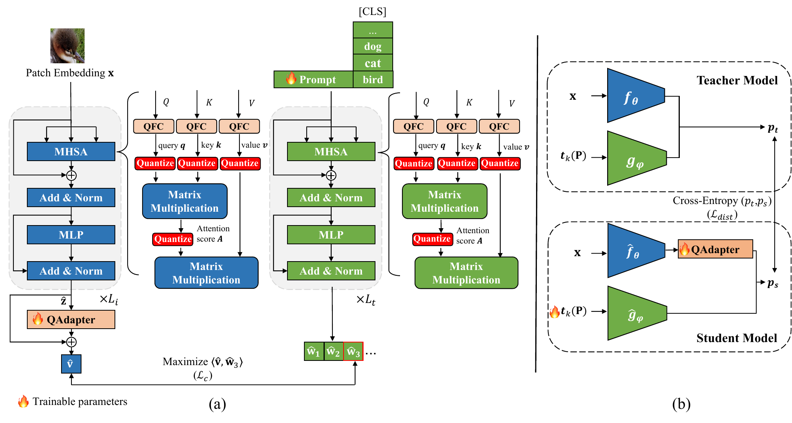

<h1 align="center">P4Q: Learning to Prompt for Quantization in Low-Bit CLIP</h1>

<p align="center" style="font-size: 1.05em">
  <strong>Huixin Sun, Runqi Wang, Yanjing Li, Chang Gao, Liping Jing, Xiaolong Jiang, Yao Hu, Baochang Zhang, Xianbin Cao</strong><br/>
  <a href="https://dl.acm.org/doi/10.1145/3822594"></a>
  <a href="https://dl.acm.org/doi/10.1145/3822594"></a>
  <a href="models/"></a>
  <a href="LICENSE"></a>
</p>

Official PyTorch implementation of [**P4Q**](https://dl.acm.org/doi/10.1145/3822594), a prompt-based framework for low-bit CLIP quantization.

<p align="center">
  
</p>

## Release

- P4Q and CLIP PTQ implementation
- Training and evaluation scripts
- Pretrained [checkpoints](checkpoints/p4q/) for CIFAR-100 with CLIP ViT-B/32 (4-4-8)

## Results

CIFAR-100 with CLIP ViT-B/32 (4-4-8):

| Method | Top-1 | Top-5 |
|--------|-------|-------|
| FP32 CLIP (zero-shot) | 65.34 | 89.00 |
| PTQ baseline (OMSE) | 46.05 | 74.47 |
| **P4Q** | **69.20** | **91.26** |

## Quick Start

### 1. Environment

```bash
conda create -n p4q python=3.10 -y && conda activate p4q
pip install -r requirements.txt
```

### 2. Dataset

Download the CIFAR-100 Python dataset and extract it as follows:

```text
data/cifar-100-python/
├── meta
├── train
└── test
```

Use `DATA_ROOT=/path/to/data` if the dataset is stored elsewhere.

### 3. Evaluation

Evaluate the 4-bit PTQ baseline:

```bash
bash scripts/test_baseline.sh
```

This reproduces the PTQ baseline in the table above (46.05 Top-1 and 74.47 Top-5).

Evaluate P4Q using the released `p4q_prompt_learner.pth` and `p4q_adapter.pth` in `checkpoints/p4q/`:

```bash
bash scripts/test_p4q.sh
```

This reproduces the P4Q result (69.20 Top-1 and 91.26 Top-5).

### 4. Training

Train P4Q from scratch and save the checkpoints to a separate directory:

```bash
SAVE_DIR=checkpoints/p4q_retrained bash scripts/train_p4q.sh
CKPT_DIR=checkpoints/p4q_retrained bash scripts/test_p4q.sh
```

Set `CUDA_VISIBLE_DEVICES=<GPU_ID>` to select a GPU.

## Citation

```bibtex
@article{sun2026p4q,
  title     = {P4Q: Learning to Prompt for Quantization in Low-Bit CLIP},
  author    = {Sun, Huixin and Wang, Runqi and Li, Yanjing and Gao, Chang and Jing, Liping and Jiang, Xiaolong and Hu, Yao and Zhang, Baochang and Cao, Xianbin},
  journal   = {ACM Transactions on Multimedia Computing, Communications, and Applications},
  publisher = {Association for Computing Machinery},
  year      = {2026},
  doi       = {10.1145/3822594}
}
```

## License

See [LICENSE](LICENSE).
